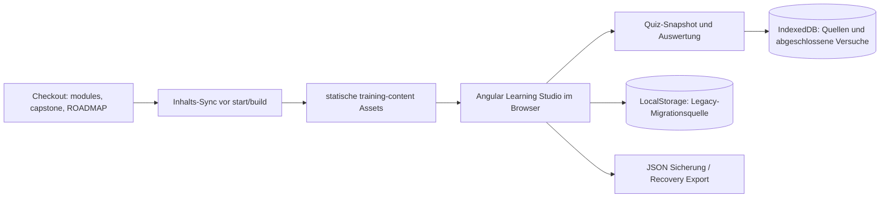

# Systemübersicht

Diese Seite beschreibt die ausgelieferten Bestandteile dieses Repositories. Sie trennt die lokale Trainingsanwendung von den fachlichen Referenzarchitekturen, die in Modulen und Capstone entworfen werden.

## Komponenten und Zuständigkeiten

| Komponente | Zuständigkeit | Laufzeit / Speicher |
|---|---|---|
| `modules/`, `capstone/`, `ROADMAP.md` | Versionierte Lektionen, Aufgaben, Fragen, Lösungen und Nachweise | Dateien im Checkout; Frontend veröffentlicht benötigte Inhalte als statische Assets |
| `frontend/` | Angular Learning Studio: Navigation, Materialanzeige, Wissenstests und lokale Lernhistorie | Browser und Angular-Entwicklungsserver oder gebaute statische Anwendung |
| `frontend/scripts/sync-training-content.mjs` | Kopiert die freigegebenen Checkout-Inhalte in `frontend/public/training-content/` vor Start und Build | Node.js; generierter, nicht versionierter Inhalt |
| `learning-tree/` | Eigenständiger Python-Katalog und Validator für Kompetenz-Gates | Python lokal; Beispielstände sind synthetisch |
| Modul-Labs und Referenzskripte | Einzelne Übungen (z. B. RAG, Tool-Calling, GPU-Training) | Je Modul dokumentierte Laufzeit; keine zentrale Laufzeitkomponente |

## Datenflüsse im Learning Studio

Die Studio-Navigation besteht aus fünf Ansichten: **Skill Tree**, **Learning Workspace**, **Assessment Center**, **Competency Dashboard** und **Training Administration**. Der Skill Tree behält Trainingsfolge und Detailbereich; die übrigen Ansichten ergänzen Material, Selbsttests, lokale Kennzahlen und lokale Quellen-/Datenverwaltung.

Das Studio lädt Manifeste, Fragen und Markdown-Dateien aus den same-origin Assets des aktuellen Checkouts. Es ruft zur Laufzeit weder GitHub-API noch `raw.githubusercontent.com` auf. Ein Testlauf verwendet einen Snapshot seiner Fragen und Regeln. Abgeschlossene Versuche und Einstellungen liegen im Browserprofil in IndexedDB; LocalStorage wird nur für die dokumentierte Legacy-Migration gelesen. JSON-Exporte ermöglichen eine manuelle Sicherung. Es gibt keine Synchronisierung, keinen Login und keinen zentralen Backend-Dienst. Details einschließlich Import-/Recovery-Verhalten beschreibt [frontend/README.md](../frontend/README.md).

## Fachliche Referenzarchitektur

Die im Training modellierte Zielarchitektur (Context Builder, Retrieval, Planner, Policy, Ausführung, MCP und Audit) ist Lerninhalt und **keine** implementierte Backend-Architektur des Learning Studios. Ihre Prinzipien und Grenzen stehen in [ARCHITECTURE.md](../ARCHITECTURE.md); die Sicherheitsbaseline ist [SECURITY.md](../SECURITY.md). Optional ausführbare Modul-Labs sind separat unter `modules/` dokumentiert.

## Grenzen und Abhängigkeiten

- Für die lokale Studio-Entwicklung sind Node.js 24.x, npm und ein aktueller Browser nötig.
- Die angezeigte Trainingsquelle entspricht dem lokalen Checkout; Inhalte erscheinen nach Neuladen bzw. erneutem Laden.
- Browserdaten sind an Profil und Origin (Schema, Host, Port) gebunden. Browserwechsel, Privatmodus und gelöschte Daten verändern den verfügbaren Stand.
- Ein lokaler Selbsttest ist kein unabhängiger Kompetenznachweis. Freigaben des Kompetenz-Lernbaums erfordern die dort definierte Evidence und Prüfung.
- Die einzelnen Labs können zusätzliche Abhängigkeiten wie Python, Docker, GPU oder separate APIs verlangen; sie sind keine Voraussetzung, um das Studio zu öffnen.

## Verwandte Einstiege

[Projekt-README](../README.md) · [Lokaler Gesamtstart](getting-started.md) · [Frontend-Bedienung](../frontend/README.md) · [Roadmap](../ROADMAP.md) · [Lernbaum](../learning-tree/README.md)
