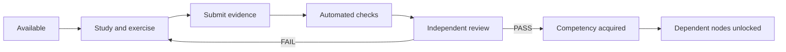

# AI Engineering Learning Tree — Architekturentscheidung v0.1

## Leitprinzip
Ein Trainingsknoten ist erst **bestanden**, wenn seine prüfbaren Gate-Kriterien tatsächlich erfüllt und freigegeben wurden. Erstellte Markdown-Dateien oder grüne Unit-Tests allein bedeuten keinen Kompetenzerwerb. Der Lernbaum ist ein DAG, kein linearer Kurskatalog.

## Komponenten
- `catalog.json`: deklarative Knoten, Abhängigkeiten (AND), Kompetenz-Gates und Freischaltungen.
- `validate.py`: überprüft den Katalog deterministisch (IDs, Referenzen, Duplikate, Zyklen, Kriterien).
- `tests/test_validate.py`: automatisierte Positiv-/Negativtests.
- `progress.example.json`: synthetischer Demonstrationsstand, **kein persönlicher Lernfortschritt**.
- `gate-policy.md`: Evidence-Vertrag, Review und Sicherheit.

## Prüfungsprozess


`locked`, `available`, `in_progress`, `submitted`, `passed`, `blocked` sind unterschiedliche Zustände. `passed` setzt sowohl bestandenes automatisches Gate als auch einen überprüfbaren Reviewer-Entscheid voraus.

## Einsatz
```bash
python learning-tree/validate.py
python -m unittest discover -s learning-tree/tests -v
```

Die bisherige Ordnerstruktur `modules/M01` bis `modules/M08` bleibt unverändert. Ein Lernbaumknoten referenziert lediglich sein bestehendes Trainingsmodul. Spezialisierungen dürfen eigene Repositories erhalten; zunächst werden sie nur im Katalog **geplant**, nicht als existierende Implementierung ausgegeben.

## Änderungsregeln
- Keine Rückdatierung oder automatische Vergabe bestandener Gates.
- Gate- und Katalogversion bei relevanten Änderungen erhöhen.
- Komplexe Bewertungsnachweise durch Reviewer prüfen; niemals nur ankreuzen.
- Ein abgebrochenes Modul sperrt nicht fachlich unabhängige Parallelpfade.
- Bereits nachgewiesene Vorkenntnisse können über **Equivalency Assessment** geprüft werden, aber nie ohne Evidence/Review freigeschaltet werden.
