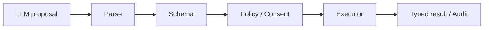

# M02 — Structured Output & Tool Calling

> 10–14 Stunden | Python 3.10+ (Standardbibliothek) | Voraussetzung M01

## Ziel
Probabilistische Tool-Vorschläge durch strikte Contracts, externe Authorization, kontrollierte Side Effects und maschinenlesbare Fehler in sichere Softwareoperationen überführen.

## Lernkapitel
- [Orientation & Trust Boundaries](lessons/00-orientation.md)
- [JSON & Structured Output](lessons/01-structured-output.md)
- [JSON Schema Contracts](lessons/02-json-schema.md)
- [Tool Calling Lifecycle](lessons/03-tool-lifecycle.md)
- [Permissions & Policy](lessons/04-policy.md)
- [Idempotency, Retry & Revision](lessons/05-retries.md)
- [Tool Security & Untrusted Results](lessons/06-security.md)
- [Hexagonal Architecture & Capstone](lessons/07-architecture.md)

## Praxis
- [Tool Contracts](examples/contracts.json) — vier deklarierte Contracts, drei ausführbare CRUD-Demo-Tools
- [Lokales Python-Labor](examples/tool_calling_lab.py) — Validierung, Denial, Idempotenz, Revision
- [15 automatisierte Tests](tests/test_tool_calling.py) — `python -m unittest discover -s tests -v`
- [Übungen](exercises/README.md) und [Referenzlösungen](solutions/README.md)
- [Evidence](evidence/README.md) und [Acceptance Criteria](evidence/acceptance-matrix.md)

## Durchführung
1. Kapitel lesen und Selbsttests schriftlich beantworten.
2. In diesem Modulverzeichnis `python examples/tool_calling_lab.py` sowie `python -m unittest discover -s tests -v` ausführen.
3. Übungen ohne Lösungen bearbeiten, dann vergleichen.
4. Acht Kriterien belegen und Review durchführen.

**Definition of Done:** Drei validierte Contracts mit Input/Output und Permission Metadata, negative Tests, Replay-/Revision-Test, unabhängige Policy-Entscheidung und dokumentierte Evidence. Das Labor ist nicht produktionssicher und führt keine echten GitHub-Mutationen durch.
