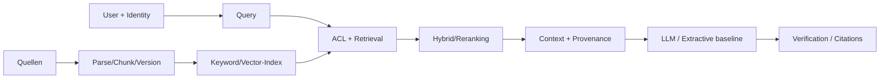

# M04 — RAG & Retrieval Engineering

> Vollständige Engineering-Lerneinheit | 14–20 Stunden | Voraussetzungen: M01–M03 | Python 3.10+ ohne Zusatzpakete

## Leitfrage
Wie baust, testest und betreibst du eine nachweisbar relevante, sichere und aktualisierbare Retrieval-Pipeline, statt bloß eine Vektordatenbank an ein LLM anzuschließen?

## Zielbild

## Lernkapitel
| Kapitel | Thema | Kompetenz |
|---|---|---|
| [00](lessons/00-orientation.md) | Orientierung | Ingestion-/Query-Pfad unterscheiden |
| [01](lessons/01-parsing-chunking.md) | Parsing & Chunking | Stabile Chunk-Identität und Versionierung |
| [02](lessons/02-embeddings.md) | Embeddings | Ähnlichkeitsmaße und Modellgrenzen |
| [03](lessons/03-retrieval.md) | Retrieval | Keyword vs Dense vs Hybrid/RRF |
| [04](lessons/04-filter-rerank.md) | Filter & Rerank | ACL-Scoping und Ranking |
| [05](lessons/05-context-grounding.md) | Context & Grounding | Belegbare Kontextzusammenstellung |
| [06](lessons/06-evaluation.md) | Evaluation | Golden Queries, Recall@k, MRR, P95 |
| [07](lessons/07-streaming.md) | Streaming-RAG | Upserts, CDC, Tombstones, Freshness |
| [08](lessons/08-security-governance.md) | Security | Injection, Tenant-Isolation, Governance |
| [09](lessons/09-capstone.md) | Capstone | Architekturvergleich mit Evidence |

## Ablauf
1. Lernkapitel der Reihenfolge nach lesen; Selbsttests in `evidence/lesson-checks.md` beantworten.
2. Lokal im Modulverzeichnis `python examples/rag_lab.py` ausführen.
3. `python -m unittest discover -s tests -v` ausführen.
4. Sechs [Übungen](exercises/README.md) selbstständig bearbeiten, danach [Referenzlösungen](solutions/README.md) prüfen.
5. Eigenes Dataset mit **mindestens 12 annotierten Golden Queries** erstellen und Konfigurationen reproduzierbar vergleichen.
6. [Evidence](evidence/README.md) und [Acceptance-Matrix](evidence/acceptance-matrix.md) vollständig nachweisen.

## Labor, Datensätze, Kriterien
- [Labor-README](examples/README.md) · [Ausführbarer Code](examples/rag_lab.py)
- [Korpus](examples/corpus.json) · [Synthetische Golden Queries](examples/golden.json)
- [Automatisierte Tests](tests/test_rag_lab.py)
- [Confluent-Quellenkritik](references/confluent-guide-review.md)

**Methodengrenzen:** Der Offline-Demonstrator nutzt TF-IDF und Hashing-Wortvektoren, **keine BM25-Implementierung und kein trainiertes semantisches Embedding**. Er implementiert auch keinen LLM-Generator. Das ist ausdrücklich keine produktionsfähige RAG-Evaluierung. Ein echtes Modell, repräsentative Daten, robuste ACLs, vollständiges Index-Lifecycle-Management und Grounding-Evaluation sind als weiterführende Arbeiten zu ergänzen.

## Quellen und Einordnung
Das bereitgestellte Confluent-Whitepaper (2025) liefert die Referenz für die vier Phasen Datenanreicherung, Inferenz, Workflows und Nachverarbeitung sowie das Streaming-Szenario. Seine Anbieterperspektive wird kritisch bewertet; Confluent, Kafka oder Flink sind **keine Pflichtabhängigkeiten** dieses Moduls. Die ergänzten Inhalte zu RRF, ACL, Golden Queries, Testmetriken und Streaming-Konsistenz sind eigenständige Engineering-Erweiterungen.

## Definition of Done
Alle acht [Acceptance Criteria](evidence/acceptance-matrix.md) erfüllt und reviewt; Tests grün; eigene Golden Queries, Benchmarkvergleich, Sicherheits-/Freshness-Tests und begründete Architekturentscheidung. **Erstellte Lernmaterialien sind kein Nachweis bestandener Übungen.**

## Wissenstest

Der modulbezogene Multiple-Choice-Test mit Fragen, Antwortmöglichkeiten, richtigen Antworten und Erklärungen liegt in [`assessment/quiz.json`](assessment/quiz.json). Das Learning Studio übernimmt diese Datei direkt. Mindestens drei von vier richtigen Antworten sind zum Bestehen erforderlich; praktische Evidence und Review bleiben separate Nachweise.
