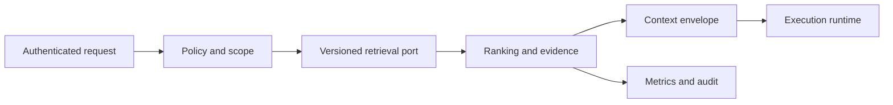

# CG-RAG Design Review und Vertical Slice

> M04 · Vertiefte Engineering-Lektion · 45–90 Minuten plus Praxis · Anspruch: erfahrener Backend-/Architektur-Engineer

## 1. Lernziele
Nach dieser Einheit kannst du das Konzept formal beschreiben, einen Architekturvertrag spezifizieren, mindestens einen negativen Test durchführen, relevante Messgrößen wählen und eine begründete Entscheidung mit Risiken und Alternativen dokumentieren.

## 2. Motivation und theoretisches Fundament
Baue einen projektagnostischen Retrieval-Port mit Versioned Knowledge Envelope, Authorized Search, Ranking, Provenance, Context Assembly und Auditing. Definiere SLOs für Index-Freshness, Query-Latenz und Security-Fails; dokumentiere bewusst noch fehlende KI-/Vektordatenbank-Implementierung.

## 3. Anwendungsfall: Cognitive Gateway
Vertical Slice: CG Registry/Docs → Parse/Chunk → index → user-scoped query → hybrid candidates → context bundle → Consumer, z.B. Forensic Analytics. Diese Pipeline ist ein **Lernentwurf**, keine Behauptung, dass alle Adapter bereits existieren.

**Einordnung des Ist-Stands:** Das CG-README beschreibt ein lokales, modellunabhängiges AI Context & Agent Control Plane mit deterministischem Rust-Kern, Ports/Adaptern und austauschbarer RAG-Anbindung. Das Beispiel oben ist eine didaktische Anwendung dieses Zielbilds und **keine Verifikation einer produktiven RAG-Funktion**. Siehe [CG README](https://github.com/MatthiasBurger-Coder/Cognitive-Gateway/blob/main/README.md).

## 4. Architektur und Vertrauensgrenzen

Für jedes Interface sind mindestens zu definieren: Eingangstyp, Exit-/Denial-Code, Source-Version, authentifizierter Scope, Latenzbudget und reproduzierbarer Test. Modelloutput und Retrieval-Text gelten als nicht vertrauenswürdig. Besonders bei Side Effects liegt die Autorisierung außerhalb des Generators.

## 5. Fehlerszenarien und Gegenmaßnahmen
Abnahme: 12+ echte Golden Queries, negative ACL/Injection Cases, Index-Delete-Tests, Konfigurationsvergleich, P95-Metriken und eine Architekturentscheidung mit Alternativen. Eigene Implementierungsbelege nötig.

Stelle für jeden Fehler drei Fragen: (a) Wo liegt der erste nachweisbare Verstoß? (b) Welche deterministische Schranke blockiert ihn? (c) Welches Log/Fixture beweist die Wirksamkeit ohne vertrauliche Daten preiszugeben?

## 6. Praktische Übung
Erstelle 10-Minuten-Review und Decision Record: Optionen, Qualitätsmessung, Betriebsrisiken, Sicherheitsgrenzen, Kosten, offene Arbeit und produktiver Übergang.

Arbeite mit `python examples/rag_lab.py` und `python -m unittest discover -s tests -v`, soweit das Szenario dort abgedeckt ist. Für darüber hinausgehende Produktionskonzepte eigene Pseudocode- oder Contract-Tests schreiben; nicht behaupten, das einfache Hashing-Labor demonstriere reale semantische Embeddings.

## 7. Selbsttest (ohne Lösung)
1. Welche Daten gehören zum verifizierbaren Input- und Outputvertrag?
2. Welche Fehlersituation ist mit einer reinen Modell-Prompt-Regel nicht beherrschbar?
3. Was beweist der vorhandene Labortest, und was gerade nicht?
4. Welche Messgröße entscheidet über dieses Design, und warum?
5. Wie wird die Grenze zum CG-Domain-/Policy-Layer erhalten?

## 8. Acceptance und Evidence
Erstelle einen eigenen Abschnitt in `evidence/lesson-checks.md` mit Architekturentscheidung, mindestens einem positiven und einem negativen Test, erwarteten/tatsächlichen Ergebnissen, Datum, Code-SHA und einer offenen Frage. Für experimentelle Teile zusätzlich `evidence/retrieval-benchmark.md`, `evidence/security-review.md` oder `evidence/streaming-review.md` referenzieren.

## 9. Weiterführende Arbeit
Übertrage die didaktische Implementierung in ein projektagnostisches Port/Adapter-Konzept; dokumentiere welche Teile unabhängig vom Retrieval-Backend bleiben. Prüfe eventuelle produktive Änderungen im CG-Repository gegen den tatsächlichen Source-Stand.
