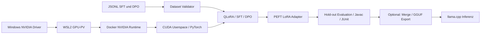

# End-to-End-Datenfluss

**Wichtige Systemgrenzen:** Windows-Treiber ist nicht im Container; Docker-GPU-Zugriff ist keine VRAM-Memory-Quota; Dataset-Bind-Mounts sind read-only; HF-Cache und Adapteroutputs bleiben Host-Volumes; nur nach unabhängiger Evaluation erfolgt ein Release.
